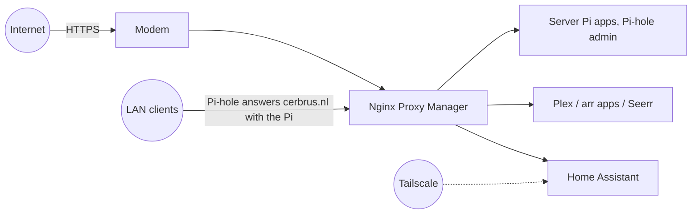
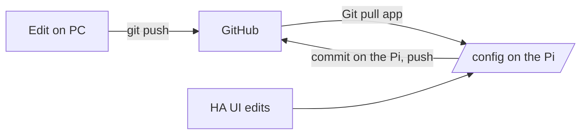

# Architecture

## Host

- Raspberry Pi 4 (64-bit) running Home Assistant OS, wired to the LAN.
- One machine carries Home Assistant Core, the reverse proxy, the media stack and the energy tooling, all as Home Assistant apps ([ADR-0001](adr/0001-single-pi-hosts-everything.md)).
- A GPIO-switched fan cools the Pi, driven by a generic thermostat on the CPU temperature ([ADR-0009](adr/0009-pi-fan-generic-thermostat.md)).
- Recorder uses the default SQLite database.

## Other machines on the network

| Machine | Role |
| --- | --- |
| Pi-hole (dedicated device) | DNS for the LAN, split-horizon answers for `cerbrus.nl` |
| Server Pi | Hobby web apps and SuggestArr ([ADR-0026](adr/0026-suggestarr-on-the-server-pi.md)), proxied through the same Nginx Proxy Manager |
| 3D printer host | OctoPrint, often powered off |

## Network path

- `cerbrus.nl` subdomains point at a DuckDNS name that follows the dynamic public address ([ADR-0002](adr/0002-public-access-duckdns-npm.md)).
- Nginx Proxy Manager is the only service reachable from outside. It terminates TLS with Let's Encrypt certificates per hostname and routes by host name ([ADR-0013](adr/0013-npm-only-public-entry.md)).
- LAN clients resolve `cerbrus.nl` names straight to the Pi through Pi-hole, so they never use the modem's NAT hairpin ([ADR-0012](adr/0012-split-horizon-dns.md)).
- Admin surfaces (proxy admin, Pi-hole admin, HA-MCP) are LAN only. Tailscale covers remote administration.
- Home Assistant Cloud is not used.

### Public host names

| Host name | Service |
| --- | --- |
| `ha` | Home Assistant |
| `plex`, `stream` | Plex |
| `movies`, `radarr` | Radarr |
| `tv`, `sonarr` | Sonarr |
| `subtitles`, `bazarr` | Bazarr |
| `indexers`, `prowlarr` | Prowlarr |
| `requests`, `seerr` | Seerr |
| `suggestions`, `suggestarr` | SuggestArr on the server Pi |
| `recipes`, `shopping`, `pokemon` | Apps on the server Pi |
| `proxy`, `pihole` | Admin UIs, LAN only |
| `404` | Custom 404 page |

## Deployment

- This repository mirrors the Pi's `/config` directory ([ADR-0004](adr/0004-config-in-git-git-pull-deploy.md)).
- YAML edits go from the PC to GitHub, the Git pull app brings them onto the Pi.
- Changes made in the HA UI (automations, scripts) land in files on the Pi and are committed and pushed from there, with a deploy key for this repository ([ADR-0023](adr/0023-commit-ui-edits-on-the-pi.md)).
- An uncommitted UI edit to a file that a pull also changes stops the Git pull app. Commit on the Pi first, then start the app again.
- Claude Code manages the running instance through HA-MCP ([ADR-0014](adr/0014-ha-mcp-in-process-lan-only.md)).

## Backups

- Home Assistant's automatic backups, copied off-site by the Google Drive Backup app ([ADR-0011](adr/0011-offsite-backups-google-drive.md)).
- The git repository is not a backup: `.storage`, secrets and the database are not in it.
