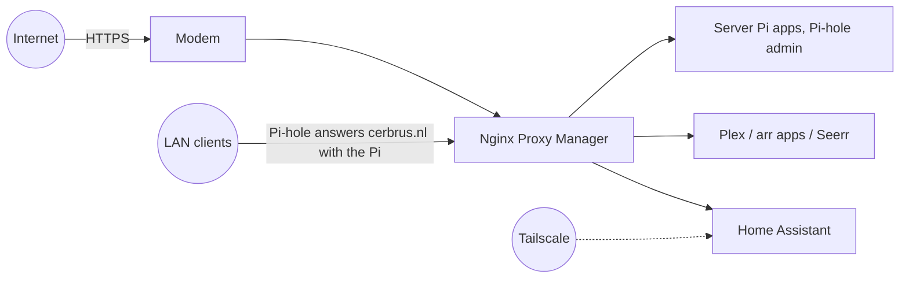
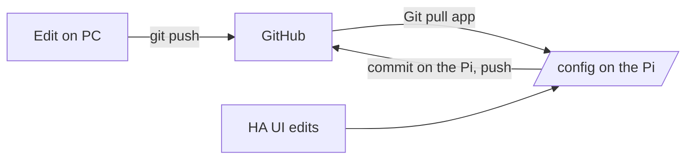

# Architecture

## Host

- Raspberry Pi 4 (64-bit) running Home Assistant OS, wired to the LAN.
- One machine carries Home Assistant Core, the reverse proxy, the media stack and the energy tooling, all as Home Assistant apps ([ADR-0001](adr/0001-single-pi-hosts-everything.md)).
- A GPIO-switched fan cools the Pi, driven by a generic thermostat on the CPU temperature ([ADR-0009](adr/0009-pi-fan-generic-thermostat.md)).
- Recorder uses the default SQLite database.

## Other machines on the network

| Machine | Role |
| --- | --- |
| Pi-hole (dedicated device) | DNS for the LAN, split-horizon answers for `cerbrus.nl` |
| Server Pi | Hobby web apps and SuggestArr ([ADR-0026](adr/0026-suggestarr-on-the-server-pi.md)), proxied through the same Nginx Proxy Manager |
| 3D printer host | OctoPrint, often powered off |

## Network path

- `cerbrus.nl` subdomains point at a DuckDNS name that follows the dynamic public address ([ADR-0002](adr/0002-public-access-duckdns-npm.md)).
- Nginx Proxy Manager is the only service reachable from outside. It terminates TLS with Let's Encrypt certificates per hostname and routes by host name ([ADR-0013](adr/0013-npm-only-public-entry.md)).
- LAN clients resolve `cerbrus.nl` names straight to the Pi through Pi-hole, so they never use the modem's NAT hairpin ([ADR-0012](adr/0012-split-horizon-dns.md)).
- Admin surfaces (proxy admin, Pi-hole admin, HA-MCP) and the media admin apps are LAN only ([ADR-0028](adr/0028-media-admin-apps-lan-only.md)). Tailscale covers remote administration.
- Home Assistant Cloud is not used.

### Host names

| Host name | Service | Reachable from |
| --- | --- | --- |
| `ha` | Home Assistant | Internet |
| `plex`, `stream` | Plex | Internet |
| `requests`, `seerr` | Seerr | Internet |
| `recipes`, `shopping`, `pokemon` | Apps on the server Pi | Internet |
| `404`, `error` | Custom error pages, one per status code (`error.cerbrus.nl/403`) | Internet |
| `movies`, `radarr` | Radarr | LAN only |
| `tv`, `sonarr` | Sonarr | LAN only |
| `subtitles`, `bazarr` | Bazarr | LAN only |
| `indexers`, `prowlarr` | Prowlarr | LAN only |
| `suggestions`, `suggestarr` | SuggestArr on the server Pi | LAN only |
| `proxy`, `pihole` | Admin UIs | LAN only |

Errors that the proxy itself produces, such as the 403 of a LAN only host or the 502 of an app that is down, show the matching page of `error.cerbrus.nl` in place, with the original address and status code. Error responses of the apps are passed through ([ADR-0030](adr/0030-proxy-error-pages-in-place.md)).

### Hardening

Decided in [ADR-0029](adr/0029-harden-public-logins.md):

- Every proxy host has Force SSL and HSTS on. Block Common Exploits is on everywhere except Plex.
- A request that matches no proxy host (the bare domain, a request by address) is redirected to `https://error.cerbrus.nl/404`. Unknown subdomains are redirected to the 404 page as well.
- Home Assistant bans an address after three failed logins. The setting is `login_attempts_threshold` under **Settings > System > Network**; it is UI-managed and not in `configuration.yaml`. Bans are written to `ip_bans.yaml` in the configuration folder; to lift one, remove the entry over SSH and restart Home Assistant. A ban on an address of the home network is lifted that way automatically ([ADR-0032](adr/0032-lift-bans-on-the-home-network.md)).
- The Home Assistant account that logs in from outside uses an authenticator app as second factor.

## Deployment

- This repository mirrors the Pi's `/config` directory ([ADR-0004](adr/0004-config-in-git-git-pull-deploy.md)).
- YAML edits go from the PC to GitHub, the Git pull app brings them onto the Pi.
- Changes made in the HA UI (automations, scripts) land in files on the Pi and are committed and pushed from there, with a deploy key for this repository ([ADR-0023](adr/0023-commit-ui-edits-on-the-pi.md)).
- An uncommitted UI edit to a file that a pull also changes stops the Git pull app. Commit on the Pi first, then start the app again.
- Claude Code manages the running instance through HA-MCP ([ADR-0014](adr/0014-ha-mcp-in-process-lan-only.md)).

## Backups

- Home Assistant's automatic backups, copied off-site by the Google Drive Backup app ([ADR-0011](adr/0011-offsite-backups-google-drive.md)).
- The git repository is not a backup: `.storage`, secrets and the database are not in it.
